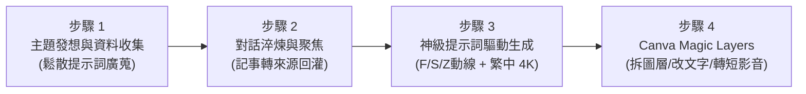

# 茶米老師 NotebookLM 資訊圖表風格一覽表

> **沃克資訊 黃信溢（茶米老師）NotebookLM 資訊圖表與簡報製作精華彙整**  
> 破解資訊過載 · 拒絕無腦直出 · 掌握 F/S/Z 視覺動線與 4K 神級提示詞工程！

---

## 🌟 專案簡介

本專案系統化收錄並建立 **黃信溢（茶米老師）** 於教育科技週、Google 講座等系列課程中，傳授之 **NotebookLM 資訊圖表製作實戰精華與風格一覽表**。

現代 AI 工具極易產生「資訊超載、字滿為患、缺乏視覺引導」的無效資訊圖表。茶米老師強調：**「圖表的核心在於精煉與視覺動線引導，而非直接把未消化的生料倒進模型！」**

本互動式一覽表系統，提供：
1. **10 大核心 NotebookLM 資訊圖表風格卡片**（配色方案、核心特徵、最適場景、中英關鍵字、一鍵複製提示詞）。
2. **茶米老師核心三大視覺動線解析**（F型循序閱讀、S型蜿蜒路徑、Z型雙向對照）。
3. **神級提示詞產生器**（在對話框直接驅動工作室，強制鎖定繁中、Noto Sans、4K 超高清品質）。
4. **4 步法實戰工作流與 Canva Magic Layers 拆圖黑科技**（圖層拆解、文字替換、一鍵加動畫轉短影音 MP4）。
5. **茶米老師 NanoBana2 擴充 20 大視覺風格庫**。
6. **YAML 結構化資訊圖表規格書模板**（乃誠/聰賢老師規範，餵給知識庫精確控制風格）。
7. **長篇簡報突破頁數上限分段生成提示詞**（1-10 頁、11-20 頁無縫銜接）。

---

## 🧭 核心三大視覺引導動線 (Visual Flows)

| 動線模式 | 視線軌跡 | 適合內容特徵 | 代表案例 |
| :--- | :--- | :--- | :--- |
| **S 型動線** (路徑引導) | 蜿蜒如河流，以箭頭與節點引導視線穿梭 | 多步驟料理、操作 SOP、成長旅程、故事探索關卡 | 威靈頓牛排零失敗食譜、咖啡手沖六步驟 |
| **F 型動線** (循序閱讀) | 由左至右、由上而下，水平掃描後垂直跳躍 | 結構嚴謹、條理分明之規章制度、手冊規範、清單 | 教職員報帳手冊、實驗室安全指引 |
| **Z 型動線** (對抗比較) | 左上至右上，對角穿透至左下再到右下 | 雙方陣營 PK、DO vs DON'T、傳統 vs AI 高效對比 | 白沙屯媽祖 vs 大甲媽祖、前後成效對照 |

---

## 🎨 收錄風格體系

### 1. 核心 10 大資訊圖表風格
- ✏️ **手繪筆記風 (Hand-drawn / Sketch Notes)**：鉛筆炭筆線條、自然留白、手作溫度。
- 💖 **可愛風 (Cute / Kawaii)**：圓角粉彩、Q版表情、消除嚴肅閱讀壓力。
- 💼 **專業商務風 (Professional / Corporate)**：俐落格線、卡片模組、深藍科技說服力。
- 🧪 **科學實驗風 (Scientific & Infographic)**：量杯刻度、因果反應、星系與公式拆解。
- 🎭 **動漫故事風 (Anime Narrative)**：主角貫穿、分鏡方格、對話氣泡、情境冒險。
- 🧱 **3D 黏土風 (3D Claymation)**：手捏泥偶微指紋光澤、親切溫暖、生活指南首選。
- 📰 **社論新聞風 (Editorial Broadsheet)**：大字頭條、雙線分欄、具權威新聞公信力。
- 🍱 **便當/教學步驟風 (Bento Grid Instructional)**：便當盒矩形網格、Step 1-N 明確指示。
- 🎲 **積木立體風 (Isometric Blocks)**：2.5D 等角透視、空間導覽與系統拓撲架構。
- 📐 **極簡扁平風 (Modern Flat Minimalist)**：極致留白、純粹幾何、數據焦點一秒直擊。

### 2. 擴充 20 款視覺風格 (茶米 NanoBana2 庫)
單色黑白、色塊極簡、時尚伸展台、復古印刷普普風、特藝彩色、哥德陶土、Dynamite爆破、沙龍寫真、素描、電影氛圍劇照、蒸氣龐克、金色日出、神話史詩戰士、超現實夢境、深沉暗影、琺瑯別針徽章、科幻生化人、柔光寫真、1930s懷舊卡通、古典油畫。

---

## 🛠️ 茶米流 4 步神級工作流



1. **資料收集**：使用鬆散提示詞，廣納百川，建立完整素材池。
2. **對話淬煉 ➔ 記事轉來源**：在對話框淬煉出精煉條列，按「儲存至記事」後點「轉換成來源」，以精華作為生圖基底。
3. **對話自動驅動**：不用在右側點擊按鈕，直接在對話框貼入動線與品質提示詞，自動召喚工作室生圖。
4. **Canva Magic Layers 後製**：語言設為英文，將生成的圖片「Magic Layers」拆解，自由修改錯字、微調圖層，並加入動畫匯出 MP4 短影音。

---

## 🚀 本地快速啟動

### 方式一：一鍵啟動（最推薦）
雙擊執行根目錄下的 **`start_local.bat`**，自動啟動本地伺服器並在瀏覽器開啟首頁：`http://localhost:8089/index.html`。

### 方式二：使用 Python 或 Node.js
```bash
# Python
python -m http.server 8089

# 或 Node.js
npx serve -l 8089 .
```
接著在瀏覽器打開：`http://localhost:8089/index.html`

---

## 📁 專案架構目錄

```
c:\antigravity\1151023-茶米NotebookLM 資訊圖表風格一覽表\
├── index.html              # 主頁面：現代深淺主題、風格展示牆、動線模擬、提示詞產生器
├── workflow.html           # 茶米老師 4 步法實戰工作流 + Canva Magic Layers 深度解密
├── prompts.html            # 神級提示詞庫、YAML 規格分析模板、簡報頁數突破法
├── start_local.bat         # Windows 一鍵啟動本地 Web 伺服器
├── README.md               # 本專案完整說明文檔
└── assets/
    ├── css/
    │   └── style.css       # 現代深淺主題樣式、玻璃擬態、響應式排版
    └── js/
        ├── data.js         # 10大核心風格 + 20大擴充風格 + YAML 模板資料庫
        └── main.js         # 搜尋篩選、主題切換、提示詞動態產生與一鍵複製
```

---

> **茶米老師金句：**  
> 「打不過 AI，就加入 AI；越逃避 AI，就越容易被 AI 取代。」
